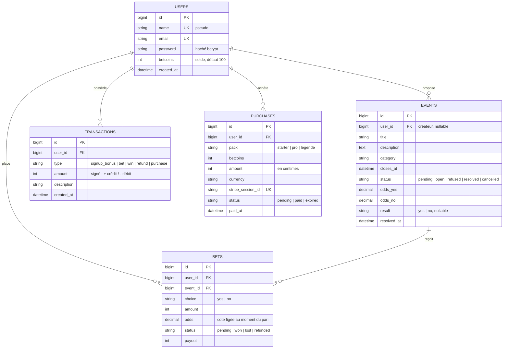
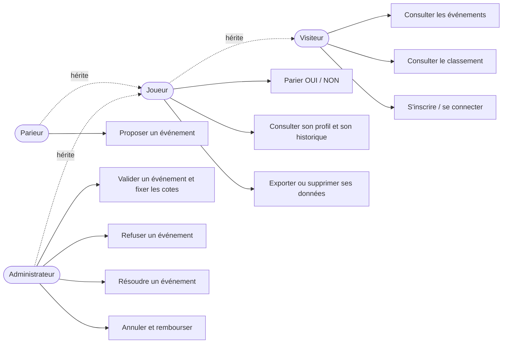
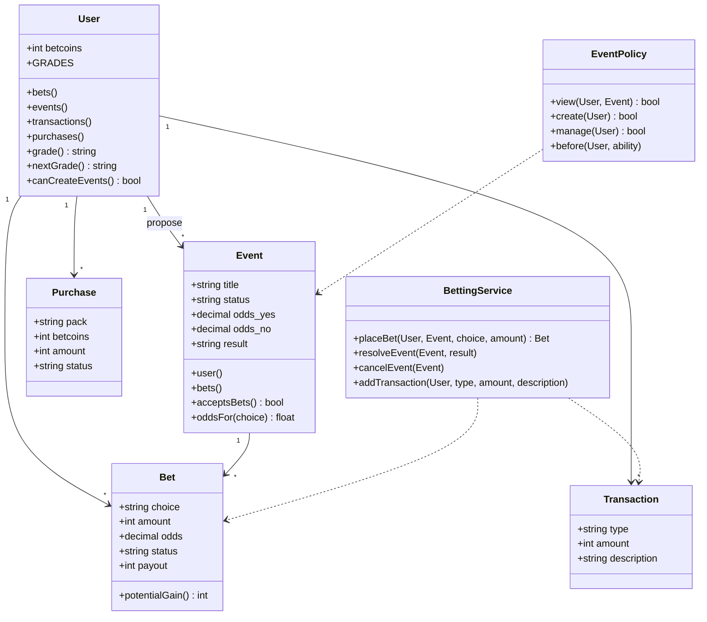
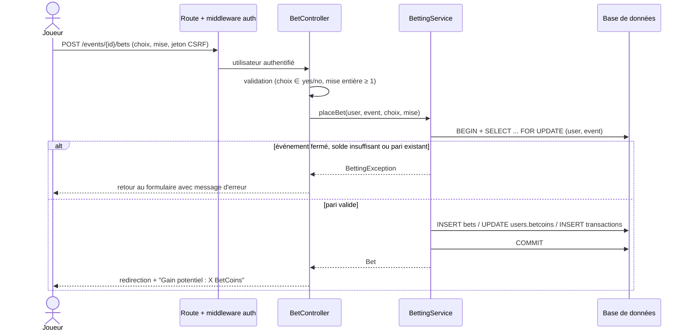
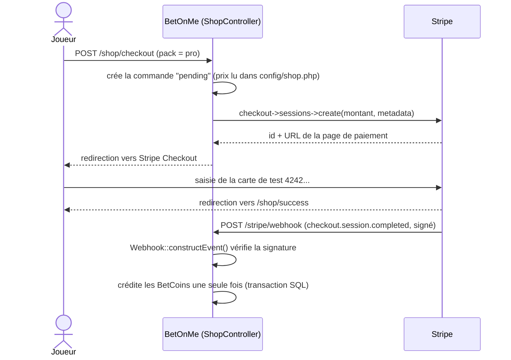
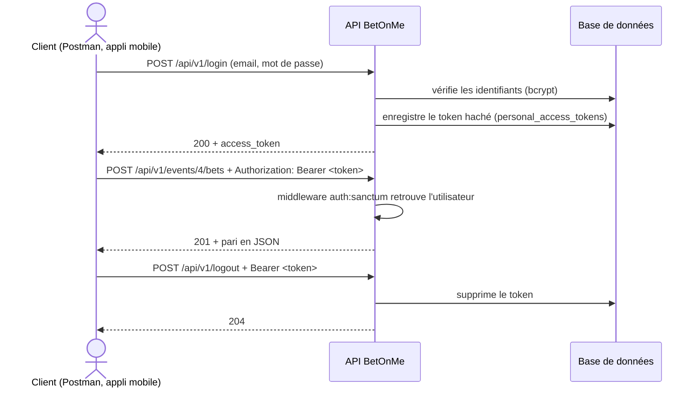

# BetOnMe — dossier de conception

Les diagrammes sont écrits en Mermaid : ils s'affichent directement sur GitHub,
ou peuvent être exportés en image depuis https://mermaid.live pour le mémoire et les slides.

## 1. Modèle de données (MCD / MLD)

Les rôles (admin, user) sont gérés par le package **spatie/laravel-permission**, qui ajoute ses propres tables
(`roles`, `permissions`, `model_has_roles`…) : on ne stocke donc pas le rôle dans la table `users`.

### Règles de gestion

1. Un utilisateur reçoit 100 BetCoins à l'inscription.
2. Un utilisateur ne peut placer qu'un seul pari par événement (contrainte UNIQUE `user_id, event_id`).
3. Un utilisateur ne peut pas parier sur un événement qu'il a proposé.
4. La mise ne peut pas dépasser le solde ; le solde est verrouillé pendant l'opération (`lockForUpdate`).
5. La cote est copiée dans le pari : si l'admin la change ensuite, les paris déjà placés ne bougent pas.
6. Gain d'un pari gagnant = `floor(mise × cote)` ; un pari perdant ne rapporte rien.
7. L'annulation d'un événement rembourse intégralement toutes les mises.
8. Le grade dépend du nombre de paris placés : Novice (0), Parieur (3), Expert (10), Légende (25).
9. Seuls les Parieurs et plus (ou les admins) peuvent proposer un événement, qui reste en attente de validation.
10. Chaque mouvement de BetCoins est tracé dans `transactions` (journalisation et audit).
11. Le prix d'un pack est fixé côté serveur ; le navigateur n'envoie que l'identifiant du pack.
12. Un achat n'est crédité qu'une seule fois, après vérification auprès de Stripe (statut payé et montant exact).
13. Jeu responsable : 3 achats maximum par période de 24 heures.

Les montants sont des **entiers** : on évite les erreurs d'arrondi des nombres à virgule flottante.

## 2. Cas d'utilisation

## 3. Diagramme de classes (back-end)

**Choix d'architecture :** les contrôleurs valident les données et appellent `Gate::authorize()` (règles dans
`EventPolicy`, l'admin passe toujours grâce à la méthode `before`). La logique qui fait bouger des BetCoins est
regroupée dans `BettingService`, pour qu'elle soit testable et toujours exécutée dans une transaction SQL.

## 4. Séquence : placer un pari

## 5. Sécurité mise en place

| Menace | Protection |
|---|---|
| Vol de mot de passe | Hachage bcrypt, mot de passe de 12 caractères minimum (recommandation CNIL) |
| Brute force | 5 tentatives de connexion par minute (`LoginRequest` façon Breeze), échecs journalisés |
| Fixation de session | Régénération de l'identifiant de session à la connexion |
| CSRF | Jeton `@csrf` sur tous les formulaires |
| Injection SQL | Requêtes préparées via Eloquent |
| XSS | Échappement automatique Blade `{{ }}` + Content-Security-Policy sans script inline |
| Clickjacking | `X-Frame-Options: DENY` et `frame-ancestors 'none'` |
| Mass assignment | `$fillable` limité : statut, cotes et résultat jamais assignables depuis un formulaire |
| Accès non autorisé | Middleware `auth` et `admin` (rôle spatie), `EventPolicy` appelée avec `Gate::authorize()` |
| Double dépense | Transaction SQL et verrou `lockForUpdate` sur le solde |
| Faux paiement | Webhook vérifié par `Stripe\\Webhook::constructEvent()` (signature HMAC, tolérance de 5 min contre le rejeu) |
| Données bancaires | Paiement sur la page Stripe Checkout : aucune carte ne transite par BetOnMe (PCI-DSS) |
| Accès à l'API | Token Sanctum (stocké haché, expire après 24 h, supprimé à la déconnexion), middleware `auth:sanctum` |
| Appels depuis un autre site | CORS limité à notre domaine, méthodes et en-têtes autorisés listés |
| Manipulation du prix | Montant lu dans le catalogue serveur et revérifié à la réception du paiement |

## 6. Couverture des compétences (état actuel)

| Bloc | Compétence | État |
|---|---|---|
| Conception | C1–C2 analyse du besoin, expertise | à rédiger dans le mémoire (base existante) |
| Conception | C3–C5 planning, budget, agilité, outils collaboratifs | à faire (ClickUp, GitHub) |
| Conception | C6 wireframes | à faire (Figma) |
| Conception | C7–C8 cahier des charges, modélisation | ce document |
| Conception | C11 RGPD | fait : cookies, politique, export, suppression |
| Conception | C12 veille | à faire |
| Front | C13–C15 interface, accessibilité, UX | fait (à auditer avec WAVE / Lighthouse) |
| Front | C16 sécurité front (CSP, en-têtes) | fait ; SSL au déploiement |
| Front | C17 consommer une API | fait : NewsAPI (clé dans `.env` envoyée en en-tête, cache 30 min, liens filtrés, page fonctionnelle si l'API tombe) |
| Front | C18–C19 tests front, build | build Vite en place ; validation W3C à faire |
| Front | C20 SEO | balises de base faites ; audit à faire |
| Back | C21 persistance sécurisée | fait (voir tableau sécurité) |
| Back | C22 langage back-end | fait |
| Back | C23 paiement | fait : Stripe Checkout (librairie stripe-php) en mode test, webhook, 3 packs, limite d'achats |
| Back | C24 API sécurisée | fait : API REST `/api/v1` avec Sanctum (tokens hachés, expiration 24 h), Resources, validation, CORS, doc Swagger |
| Back | C25 tests back (≥ 50 %) | 68 tests PHPUnit ; couverture à mesurer avec `php artisan test --coverage` |
| Back | C26 industrialisation | à faire (GitHub Actions) |

## 7. Séquence : achat de BetCoins avec Stripe

**Monétisation :** le jeu reste entièrement gratuit (100 BetCoins offerts, gains en jouant). La boutique est un modèle
*freemium* : les joueurs qui ont tout perdu ou qui visent le classement peuvent recharger leur solde. Les BetCoins
n'ont aucune valeur de revente, ce qui maintient BetOnMe hors du champ des jeux d'argent réglementés.

## 8. Séquence : authentification par token (API)

