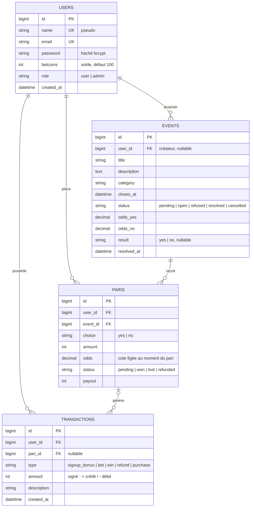
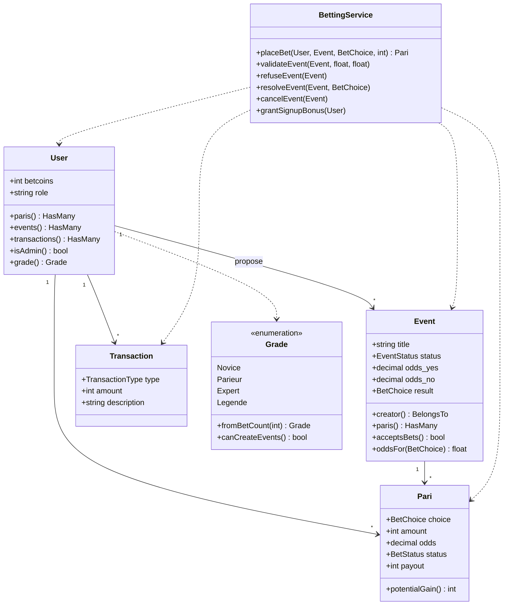
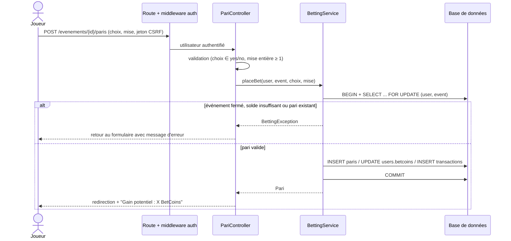

# BetOnMe — dossier de conception

Les diagrammes sont écrits en Mermaid : ils s'affichent directement sur GitHub,
ou peuvent être exportés en image depuis https://mermaid.live pour le mémoire et les slides.

## 1. Modèle de données (MCD / MLD)

### Règles de gestion

1. Un utilisateur reçoit 100 BetCoins à l'inscription.
2. Un utilisateur ne peut placer qu'un seul pari par événement (contrainte UNIQUE `user_id, event_id`).
3. Un utilisateur ne peut pas parier sur un événement qu'il a proposé.
4. La mise ne peut pas dépasser le solde ; le solde est verrouillé pendant l'opération (`lockForUpdate`).
5. La cote est copiée dans le pari : si l'admin la change ensuite, les paris déjà placés ne bougent pas.
6. Gain d'un pari gagnant = `floor(mise × cote)` ; un pari perdant ne rapporte rien.
7. L'annulation d'un événement rembourse intégralement toutes les mises.
8. Le grade dépend du nombre de paris placés : Novice (0), Parieur (3), Expert (10), Légende (25).
9. Seuls les Parieurs et plus (ou les admins) peuvent proposer un événement, qui reste en attente de validation.
10. Chaque mouvement de BetCoins est tracé dans `transactions` (journalisation et audit).

Les montants sont des **entiers** : on évite les erreurs d'arrondi des nombres à virgule flottante.

## 2. Cas d'utilisation

## 3. Diagramme de classes (back-end)

**Choix d'architecture :** les contrôleurs restent fins (validation de la requête, réponse HTTP).
Toute la logique qui modifie des BetCoins est centralisée dans `BettingService`, ce qui la rend
testable indépendamment et garantit que chaque opération se fait dans une transaction SQL.

## 4. Séquence : placer un pari

## 5. Sécurité mise en place

| Menace | Protection |
|---|---|
| Vol de mot de passe | Hachage bcrypt, mot de passe de 12 caractères minimum (recommandation CNIL) |
| Brute force | 5 tentatives de connexion par minute (RateLimiter), échecs journalisés |
| Fixation de session | Régénération de l'identifiant de session à la connexion |
| CSRF | Jeton `@csrf` sur tous les formulaires |
| Injection SQL | Requêtes préparées via Eloquent |
| XSS | Échappement automatique Blade `{{ }}` + Content-Security-Policy sans script inline |
| Clickjacking | `X-Frame-Options: DENY` et `frame-ancestors 'none'` |
| Mass assignment | `$fillable` limité : statut, cotes et résultat jamais assignables depuis un formulaire |
| Accès non autorisé | Middleware `auth` et `admin`, Gates `create-event` et `view-unpublished-event` |
| Double dépense | Transaction SQL et verrou `lockForUpdate` sur le solde |

## 6. Couverture des compétences (état actuel)

| Bloc | Compétence | État |
|---|---|---|
| Conception | C1–C2 analyse du besoin, expertise | à rédiger dans le mémoire (base existante) |
| Conception | C3–C5 planning, budget, agilité, outils collaboratifs | à faire (ClickUp, GitHub) |
| Conception | C6 wireframes | à faire (Figma) |
| Conception | C7–C8 cahier des charges, modélisation | ce document |
| Conception | C11 RGPD | fait : cookies, politique, export, suppression |
| Conception | C12 veille | à faire |
| Front | C13–C15 interface, accessibilité, UX | fait (à auditer avec WAVE / Lighthouse) |
| Front | C16 sécurité front (CSP, en-têtes) | fait ; SSL au déploiement |
| Front | C17 consommer une API | à faire (NewsAPI) |
| Front | C18–C19 tests front, build | à faire (validation W3C, Vite) |
| Front | C20 SEO | balises de base faites ; audit à faire |
| Back | C21 persistance sécurisée | fait (voir tableau sécurité) |
| Back | C22 langage back-end | fait |
| Back | C23 paiement | à faire (Stripe en mode test : achat de BetCoins) |
| Back | C24 API sécurisée | à faire (Laravel Sanctum) |
| Back | C25 tests back (≥ 50 %) | 38 tests PHPUnit ; couverture à mesurer |
| Back | C26 industrialisation | à faire (GitHub Actions) |
